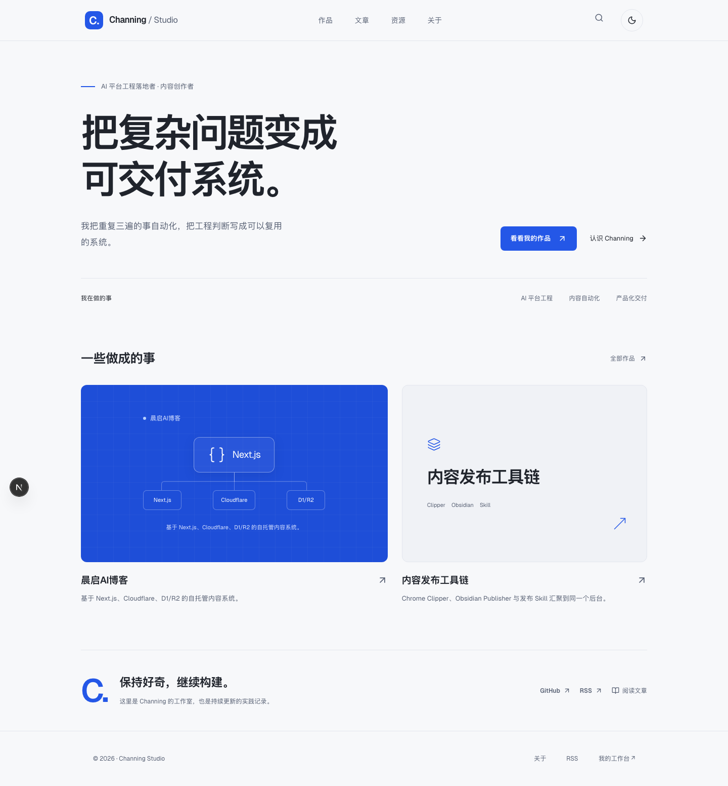

# Channing Studio

Channing 的个人工作室、技术写作和内容工具箱。

这里记录三类东西：能真正交付的 AI 平台工程、把重复工作串起来的自动化工具，以及我愿意长期复用的工具和提示词。文章、工具和提示词都由 Cloudflare D1 动态管理，图片和媒体放在 R2。

在线站点：<https://note.aichanning.cn>

独立仓库：<https://github.com/JavaArthur/channing-studio>



## 站点结构

| 路径 | 内容 |
|---|---|
| `/` | 个人身份、项目、工具、提示词和最新文章 |
| `/writing` | 文章归档 |
| `/work` | 公开项目 |
| `/labs` | 实验室、生态工具和正在验证的工作流 |
| `/tools` | 工具、仓库和软件收藏 |
| `/prompts` | 可复制的提示词收藏 |
| `/admin` | 后台登录 |
| `/admin/studio` | 工作室身份、项目和实验室配置 |
| `/admin/tools` | 工具收藏管理 |
| `/admin/prompts` | 提示词管理 |
| `/editor?new=1` | 新建文章 |

## 内容怎么发布

登录 `https://note.aichanning.cn/admin` 后：

1. 文章进入 `/admin/posts`，或者打开 `/editor?new=1` 新建。
2. 首页身份、项目、实验室和精选文章在 `/admin/studio` 修改。
3. 工具收藏在 `/admin/tools` 管理，保存后会出现在 `/tools` 和首页工具箱。
4. 提示词在 `/admin/prompts` 管理，公开内容出现在 `/prompts`；复制操作只发生在浏览器，不会把正文发送到第三方服务。

后台密码只存在 Cloudflare secret `ADMIN_PASSWORD`，不写进仓库。

## 本地开发

```bash
git clone https://github.com/JavaArthur/channing-studio.git
cd channing-studio
npm install
npm run dev:next
```

只改 UI 或纯逻辑时，`npm run dev:next` 就够了。需要 Worker、D1 或 R2 行为时，准备本地未追踪的 `wrangler.local.toml`，再运行：

```bash
npm run preview
```

不要把真实 `wrangler.local.toml`、`.env.local` 或备份 SQL 提交到 Git。

## 验证与部署

```bash
npm run verify:quick
npm run cf-typegen
npx opennextjs-cloudflare build
OPEN_NEXT_DEPLOY=true npx wrangler deploy -c wrangler.local.toml
```

已有 D1 数据库时不要使用会重复执行 schema 的旧部署脚本。表结构变更先执行 migration：

```bash
npx wrangler d1 export DB --remote --output=backup-$(date +%F).sql -c wrangler.local.toml
npx wrangler d1 execute DB --remote --file=db/migrations/你的迁移.sql -c wrangler.local.toml
```

## 数据架构

- `posts`：文章、草稿、分类、发布状态和阅读数据。
- `site_settings`：导航、主题和工作室配置。
- `tools`：工具收藏及其标签、图标、排序。
- `prompts`：提示词正文、分类、来源、隐藏/置顶状态和排序。
- R2：文章图片、封面和媒体。

## 生态工具

- [Chrome Clipper](ecosystem/chrome-clipper/)：把网页剪成博客草稿。
- [Obsidian Publisher](ecosystem/obsidian-publisher/)：从 Obsidian 发布笔记。
- [Blog Publish Skill](ecosystem/channing-blog-publish-skill/)：通过 Agent 工作流准备和发布文章。


## 安全检查

提交前确认：

```bash
git ls-files | rg '(^|/)(\.env($|\.)|\.pem$|\.key$|wrangler\.local\.toml$)' || true
git grep -n -I -E '(BEGIN (RSA|OPENSSH|EC|PGP) PRIVATE KEY|AKIA[0-9A-Z]{16}|ghp_|github_pat_|CLOUDFLARE_API_TOKEN=|ADMIN_PASSWORD=)' -- ':!package-lock.json' ':!.env.example' || true
```

如果怀疑密码或 Token 泄露，先在对应平台轮换，再清理 Git 历史；不要只删除当前文件。

## 许可证

MIT
